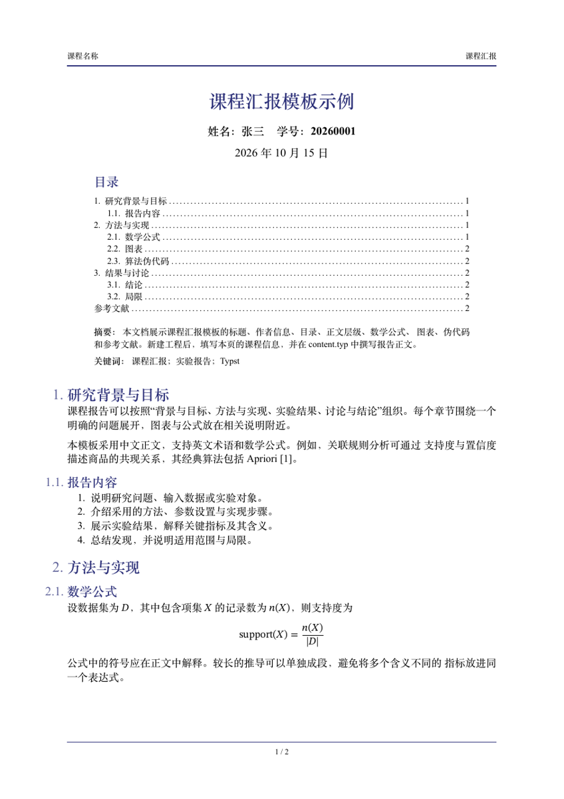

# Typst Templates

个人 Typst 模板库。每种模板独立存放、安装和选择，使用 Typst 原生的 `@local` 包与 `typst init` 创建新工程。Python 与 Typst 版本由 mise 管理，脚本使用 mise 的共享 Python 运行时。

## 模板目录

| 模板 | 类型 | 包名 | 预览 |
| --- | --- | --- | --- |
| [course-report](templates/course-report/) | 中文课程汇报、实验报告 | `@local/course-report:0.1.0` | [PDF](previews/course-report.pdf) |



## 本机新建报告

模板库位于 `~/Documents/typst-templates`：

```sh
cd ~/Documents/typst-templates
mise run templates -- course-report
mise run new -- @local/course-report:0.1.0 ../my-report
cd ../my-report
mise trust
mise run compile
```

填写 `main.typ` 中的题目、课程、姓名、学号、摘要与关键词，在 `content.typ` 中撰写正文。图表、参考文献和算法组件的使用示例已包含在工程内。创建目录也可换成所需课程文件夹的绝对路径。

新工程自带 `mise.toml`，与模板库复用相同的 Python、Typst 版本：

```sh
mise run compile             # 生成 report.pdf
mise run watch               # 持续编译
mise run python -- script.py # 运行脚本
```

## mise 环境与任务

`mise.toml` 固定 Python 3.14.7 与 Typst 0.15.1。安装工具后，同版本运行时可供各工程共同使用。

模板库根目录提供以下任务，参数通过 `--` 传入：

| 任务 | 示例 | 用途 |
| --- | --- | --- |
| `templates` | `mise run templates -- --list` | 列出或安装模板 |
| `new` | `mise run new -- @local/course-report:0.1.0 ../my-report` | 新建工程 |
| `compile` | `mise run compile -- path/main.typ path/report.pdf` | 编译指定文档 |
| `watch` | `mise run watch -- path/main.typ path/report.pdf` | 持续编译指定文档 |
| `python` | `mise run python -- scripts/install.py --list` | 运行 Python 脚本 |

## 在其他电脑安装

先安装 [mise](https://mise.jdx.dev/getting-started.html)，再执行：

```sh
git clone https://github.com/hyskr/typst-templates.git
cd typst-templates
mise trust
mise install
mise run templates -- --list
mise run templates -- course-report
mise run new -- @local/course-report:0.1.0 ../my-report
```

省略模板名称时安装库内所有模板：

```sh
mise run templates
```

安装脚本将模板复制到 Typst 本地包目录。macOS 默认路径为 `~/Library/Application Support/typst/packages/local/`，Linux 使用 `$XDG_DATA_HOME/typst/packages/local/` 或 `~/.local/share/typst/packages/local/`，Windows 使用 `%APPDATA%/typst/packages/local/`。已设置 `TYPST_PACKAGE_PATH` 时使用该目录。

## 模板信息与样式

[课程报告参数说明](templates/course-report/README.md)列出了题目、课程、作者、学号、日期、目录及字体等参数。排版基于 grape-suite 4.0.0，保留中文日期、标题下居中的姓名学号与日期、简洁页眉以及原有配色。

默认正文使用 Times New Roman 与 Songti SC。其他系统可在 `text-font` 中指定已安装的中文字体。示例姓名和学号仅用于演示。

## 添加 slide 或其他模板

在 `templates/` 下为新模板建立独立目录，例如 `templates/course-slides/`，使用标准 Typst 包结构：

```text
templates/<template-name>/
├── typst.toml
├── lib.typ
├── README.md
└── template/
    └── main.typ
```

在 `typst.toml` 的 `[package]` 中设置 `name`、`version`、`entrypoint`，在 `[template]` 中设置 `path`、`entrypoint`。安装脚本会自动识别该目录。

```sh
mise run templates -- --list
mise run templates -- course-slides
mise run new -- @local/course-slides:0.1.0 ../my-slides
```

上述 slide 命令用于新增相应模板后。当前可选模板以 `--list` 的输出为准，各类工程使用各自的包名和版本。

## 修改与版本

编辑 `templates/course-report/` 中的库文件或工程骨架后，重新运行安装命令，将变更同步到本机包目录。发布新的稳定样式时更新版本号，并同步 `template/` 内的导入版本。既有工程可继续使用原版本，新工程选择新版本。

## 目录结构

```text
typst-templates/
├── mise.toml           # 工具版本与编译、脚本任务
├── templates/           # 每个子目录是一种可选模板
│   └── course-report/
├── scripts/install.py  # 列出、安装指定模板
└── previews/           # 模板预览 PDF
```

## 许可

本仓库采用 MIT 许可。课程报告使用的 grape-suite 源码保留上游作者 Tristan Pieper 的版权与许可，详见 `templates/course-report/vendor/grape-suite/LICENSE`。
